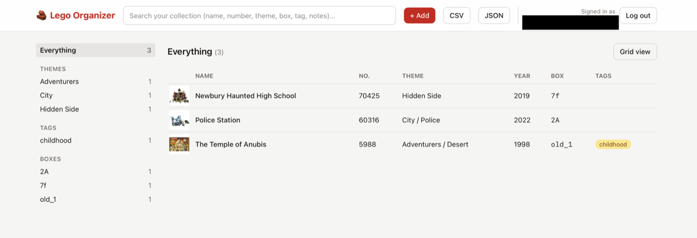
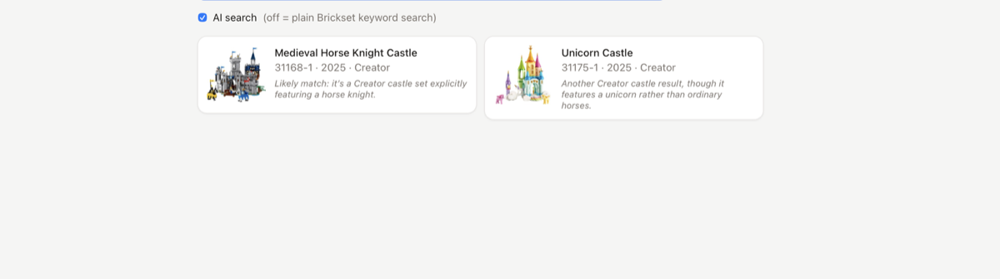
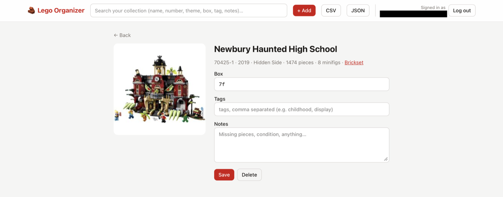
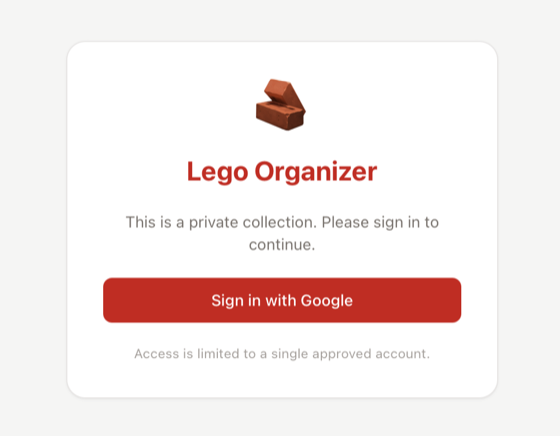

# 🧱 Lego Organizer

A private web app for cataloguing a Lego collection and remembering **which storage box each set is in**.

You describe a set in your own words ("the pharaoh temple from the 90s"), type or speak it, and a small AI agent
finds the real set on [Brickset](https://brickset.com). You pick the right one, write down the box number,
and later find it again by theme, tag, box or full-text search.

## Features

- **Add by description, voice or keywords.** An AI search agent (OpenAI Luna) looks sets up on Brickset and
  offers ranked candidates with pictures; you choose. A toggle turns AI off for plain Brickset keyword search.
  A mic button transcribes speech with OpenAI.
- **Box-based organisation.** Every item records the ID on its storage box (`587B`, `Star Wars 3`, anything).
  Each box has a page listing what's inside.
- **Browse like BrickLink.** Drill down Theme → Subtheme, or browse by your own **tags** (`childhood`, `display`…)
  and by box. Grid or table view.
- **Find fast.** Instant full-text search (BM25 via SQLite FTS5) over name, number, theme, tags, box and notes.
- **Other items.** Spares, loose minifigs and separator boxes are catalogued as free-text "other" items.
- **Notes, edit, delete, export.** Per-item notes (missing pieces…), CSV and JSON export for backups.
- **Private.** Google sign-in; only one configured email can get in.

## Screenshots

**Browse your collection** by theme, tag or box, in a table (or card grid):

<p align="center"></p>

**Describe a set in your own words** (type or speak it) and pick the real one the AI finds on Brickset:

<p align="center"></p>

**Record which box it's in**, add tags and notes:

<p align="center"></p>

**Private by design**: Google sign-in for a single approved account:

<p align="center"></p>

## Tech stack

Python 3.12+ · FastAPI · SQLite (FTS5) · SQLAlchemy · PydanticAI · React · TypeScript · Vite · Tailwind CSS · Docker

How the pieces fit and why they were chosen: **[docs/architecture.md](docs/architecture.md)**.

## Getting started

### 1. Get the keys

| Setting | Where to get it |
|---|---|
| `BRICKSET_API_KEY` | https://brickset.com/tools/webservices/requestkey (free) |
| `OPENAI_API_KEY` | https://platform.openai.com/api-keys (used for AI search and voice) |
| `GOOGLE_CLIENT_ID` / `GOOGLE_CLIENT_SECRET` | Google Cloud Console → APIs & Services → Credentials → *Create OAuth client ID* → **Web application**. Add the authorized redirect URI `http://localhost:8000/auth/callback`. If the consent screen is in testing mode, add your email as a test user. |
| `ALLOWED_EMAIL` | The one Google account allowed to sign in |
| `SESSION_SECRET` | Any long random string (`openssl rand -hex 32`) |

```bash
cp .env.example .env     # then fill it in
```

Always open the app at the address in `BASE_URL` (default `http://localhost:8000`). Cookies are host-bound, so
`127.0.0.1` and `localhost` are different sites to the login flow.

### 2a. Run with Docker

```bash
docker compose up --build            # http://localhost:8000
docker compose run --rm app python -m app.seed   # optional: load 4 example sets (works offline)
```

Your data lives in the Docker volume `lego-data` (a host folder would need `chown 10001`, because the app runs
as a non-root user). Back it up with the in-app CSV/JSON export, or copy the file out:
`docker compose cp app:/data/lego.db ./backup.db`. The image runs database migrations on every start.
Compose needs the `docker compose` plugin (Homebrew: `brew install docker-compose`). If you use plain
`docker run --env-file .env`, delete the inline `# comments` in `.env` first, because Docker does not strip them.

### 2b. Run for development

```bash
# backend (API on :8000)
cd backend && uv sync && uv run uvicorn app.main:app --reload

# frontend (UI on :5173, proxies /api and /auth to :8000)
cd frontend && npm install && npm run dev
```

When using the Vite dev server, set `BASE_URL=http://localhost:5173` and register
`http://localhost:5173/auth/callback` as a second redirect URI in Google. For a production-style run, build the
frontend (`npm run build`) and the backend serves it on :8000.

A fresh clone starts with an empty collection; the SQLite file and its folder are created automatically on first
start. To see the app with data right away, load the example sets (`cd backend && uv run python -m app.seed`);
they come from [`seed_data.json`](backend/app/seed_data.json), need no API keys, and can be deleted in the app.
Brickset and OpenAI keys are only needed to add *new* sets.

Run the tests (no keys or network needed):

```bash
cd backend && uv run pytest
```

## Configuration

All settings are environment variables (see [`.env.example`](.env.example)). The ones you may want to tune:

| Variable | Default | Meaning |
|---|---|---|
| `AGENT_MODEL` | `gpt-6-luna` | OpenAI model for the add-a-set agent |
| `AGENT_REASONING_EFFORT` | `none` | Reasoning level sent to the model (empty = provider default) |
| `AGENT_MAX_STEPS` | `3` | Max Brickset searches the agent may make per request |
| `TRANSCRIBE_MODEL` | `gpt-4o-transcribe` | OpenAI model for voice input |
| `DATABASE_URL` | `sqlite:///./data/lego.db` | Relative SQLite paths resolve from the directory the server starts in |

## How this was built

This project was designed and written with an AI coding assistant, using a deliberate process rather than one big prompt:

1. **Interview first.** The work started with the `grilling` skill from Matt Pocock's open-source
   [**mattpocock/skills**](https://github.com/mattpocock/skills) plugin (v1.3.1) for Claude Code. The skill
   interviews you in rounds of numbered questions, each with a recommended answer, and works through a *design
   tree* until no decision is left implicit. Four rounds settled the storage model, data source, AI flow, search
   behaviour, auth and scope, and what to leave out.
2. **Written plan.** The outcome was captured in [docs/plan.md](docs/plan.md) before any code existed.
3. **Implementation with Claude Code** ([Claude Sonnet 5.5](https://www.anthropic.com/claude)), backend first,
   with tests alongside using faked Brickset and OpenAI so they run offline.
4. **Verification against the real services.** Brickset, OpenAI and Google login were exercised live. That
   surfaced real fixes that no mock would have: remembered set names rarely match official titles (so the agent
   gained theme/year filters), the agent could overrun its search budget (so it now searches one at a time and
   degrades gracefully), and a `localhost` vs `127.0.0.1` cookie mismatch broke OAuth (so login now redirects to
   the canonical host).

The plan's final section lists where the implementation deliberately departs from it.

## Security

Single-user by design: Google sign-in restricted to one verified email, strict security headers, hardened file
serving, non-root container, and no secrets in git. Details, threat model and a Cloud Run checklist:
**[docs/security.md](docs/security.md)**. If you deploy this, set a strong `SESSION_SECRET` (the app refuses to start without one).

## Status

This is the pre-deployment version (v0.1). It runs locally with real Brickset data, AI search and Google login.
The code is ready for Cloud Run (Alembic migrations, Litestream replication to a GCS bucket, `/healthz`, JSON
logs, pinned Docker images; the image builds and the backup-and-restore cycle was tested against a local replica).
CI (lint, tests, audits, secret scan, image smoke test) and a keyless GitHub-to-Cloud-Run deploy workflow are written.
Not yet done: running the GCP setup and the first real deploy: follow [docs/deploy.md](docs/deploy.md).
The concrete next steps to a GCP deployment are in **[TODO.md](TODO.md)**.
See also [Known gaps](docs/architecture.md#known-gaps--next-steps).

## License

Copyright © 2026 Matej Kvassay. All rights reserved. The source is published for viewing, as a portfolio
project; no licence to copy, modify or redistribute it is granted.

## Acknowledgements

Set data and images from [Brickset](https://brickset.com). LEGO® is a trademark of the LEGO Group, which is not
affiliated with this project.
