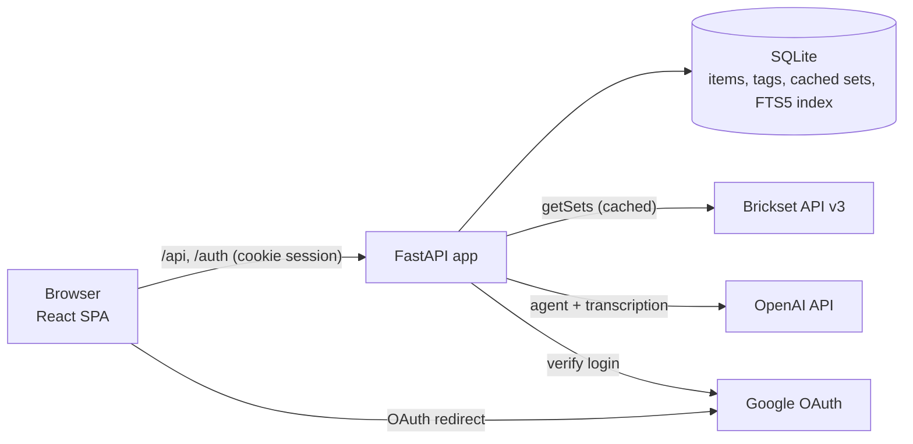
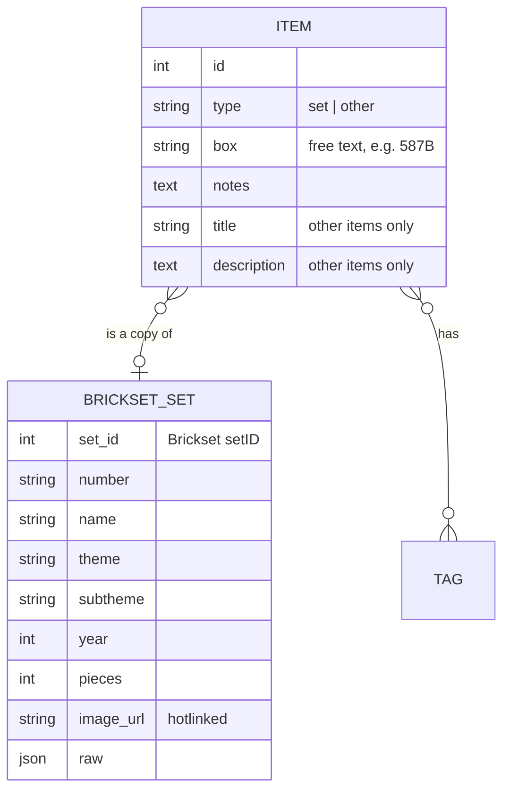
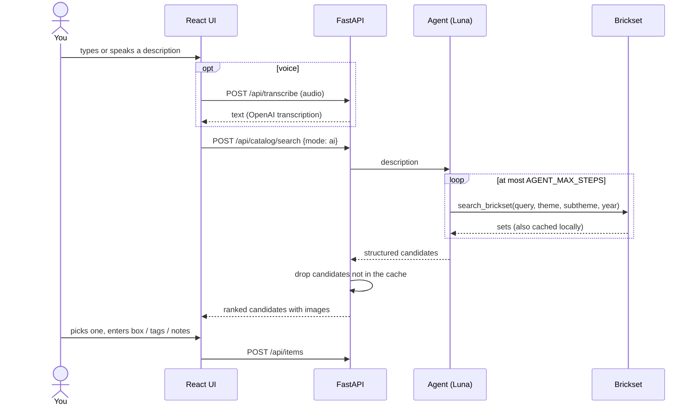

# Architecture

Lego Organizer is a small single-user web app: a FastAPI backend with a SQLite database, a React single-page
frontend, and two external services (Brickset for set data, OpenAI for the AI search and voice input).



In production one container serves both: FastAPI mounts the built frontend (`frontend/dist`) and falls back to
`index.html` for client-side routes.

## Repository layout

```
backend/
  app/
    main.py         app factory, sessions, static frontend
    config.py       all settings (env / .env) via pydantic-settings
    auth.py         Google OAuth login, single allowed email
    api.py          HTTP routes (/api/...)
    service.py      item create / update / delete rules
    search.py       SQLite FTS5 index + BM25 ranking for the collection
    brickset.py     Brickset client + local cache
    agent.py        PydanticAI "find this set" agent
    transcribe.py   OpenAI speech-to-text
    models.py       SQLAlchemy tables
    schemas.py      Pydantic request/response models
    seed.py         optional example data
  tests/            pytest (Brickset and OpenAI are faked)
frontend/src/       React app (App, route, api client, components/)
docs/               this file and the original plan
```

## Data model



- An **item** is one physical thing you own: a Lego **set** (linked to a cached Brickset record) or an **other**
  item (spares, minifigs, separators: a title and description only). Owning a set twice means two items.
- The **box** is just a string. Boxes have no table: the box list, autocomplete and box pages are derived from
  what items use. This keeps the "sticker on a storage box" workflow free of setup.
- **Tags** are your own categories (many-to-many, created as you type, deleted when unused). Brickset's theme and
  subtheme provide the built-in categories.
- `brickset_sets` is a cache. A set is fetched once and then served locally, which keeps usage low against
  Brickset's daily API limit.

## Key flows

### Adding a set (AI mode)



The model never writes to the catalog and never invents data that reaches it: it can only return sets that the
search tool actually returned, and the backend discards any candidate that is not in the local Brickset cache.
You always make the final choice. If the search budget runs out first, the raw matches found so far are shown,
marked as unranked. Switching AI off sends the text straight to Brickset's keyword search.

### Finding things in your collection

Search over your own items is deliberately **not** AI: a SQLite FTS5 table indexes title, set number, theme,
subtheme, tags, box and notes, with prefix matching and BM25 ranking (columns weighted so name and number outrank
notes). It is instant, free, and works offline. Browsing is a Brickset-style drill-down (theme, then subtheme),
with tags and boxes as extra entry points; both come from one `/api/facets` call.

### Authentication

Google OAuth (authlib). The callback accepts a login only if the verified Google email equals `ALLOWED_EMAIL`;
the result is a signed cookie session. Every `/api` route requires that session. The login redirect first moves
the browser to the host in `BASE_URL`, because the session cookie is host-bound (`localhost` and `127.0.0.1`
are different hosts to a browser, and mixing them breaks the OAuth state check).

## Decisions and trade-offs

| Decision | Why | Cost / alternative |
|---|---|---|
| FastAPI + SQLite | One file to back up, zero services to run, enough for ~hundreds of items | Cloud Run's disk is ephemeral, so deployment needs replication (Litestream) or a move to Postgres |
| SQLAlchemy without Alembic (for now) | Fastest path to v1 | Schema changes will need migrations before the data is precious |
| Brickset as the only data source | Rich set data, free key, one source to reason about | Daily API limit, mitigated by caching every set and capping the agent's searches |
| Images hotlinked, not downloaded | Simplest; the owner chose it for v1 | Images break if the source URL dies; downloading to disk or GCS is a contained later change |
| A small agent with one tool, structured output | Handles fuzzy memories ("the pharaoh castle from the 90s") without vector search or a big model | Needs an LLM call per lookup; limited by Brickset's search quality |
| Collection search is BM25, not AI | Fast, free, predictable, no data leaves the machine | No semantic matching |
| Voice = record in browser, transcribe on the server | Works in any browser, one provider and one key | Audio is sent to OpenAI; costs a little |
| React + Vite + Tailwind, no router/state libs | Mainstream and low-dependency; a tiny hash router is enough for three screens | Would need a real router if the app grows |
| Single user, one allowed email, no bypass | The data is personal; one auth path means the tested path is the real one | Not multi-user; adding users means a users table and per-user data |
| Config only through environment variables | Same image runs locally and in the cloud | Secrets must be supplied by the environment |

## Testing

`backend/tests` runs against a temporary SQLite file with Brickset replaced by an in-memory catalog and the
OpenAI model replaced by a scripted fake (`pydantic_ai`'s `FunctionModel`), so the suite is fast and needs no
keys. It covers the add flow, FTS search ranking, edit/delete (including index and tag cleanup), exports,
cache-first lookups, hallucinated-candidate filtering, and the auth rules. Live behaviour against Brickset and
OpenAI was checked manually.

## Known gaps / next steps

- Deployment is designed for but not done: Docker image and Compose file exist; Cloud Run needs SQLite
  persistence (Litestream to a GCS bucket) and a registered production redirect URI.
- Alembic migrations.
- Optional: download and store images, price tracking, parts and minifig inventories.
